# TallyBook

一款 Kotlin + Jetpack Compose 的 Android 记账本，**单币种、离线优先、金额零误差**。

当前状态：**v0.1.0 Beta**。已在 Android 模拟器（API 36）上跑通完整链路：
记一笔 → 保存 → 月分组列表 → 长按删除 → 撤销 → 合计同步更新。

```
./gradlew :app:assembleDebug    ✅ app-debug.apk
JVM 测试                        ✅ 138 tests, 0 failures
真机仪器化测试                   ✅ 22 tests, OK
```

---

## 界面

| 明细 | 记一笔 |
| --- | --- |
| 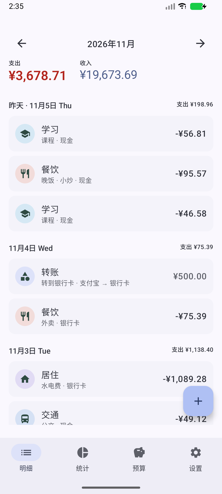 | 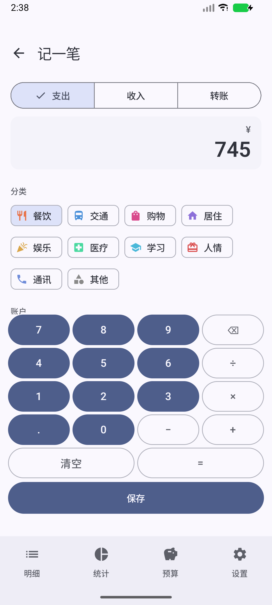 |

| 统计（周/月/年 × 支出/收入/两者） | 预算（周/月 + 配速 + 期末推算） |
| --- | --- |
| 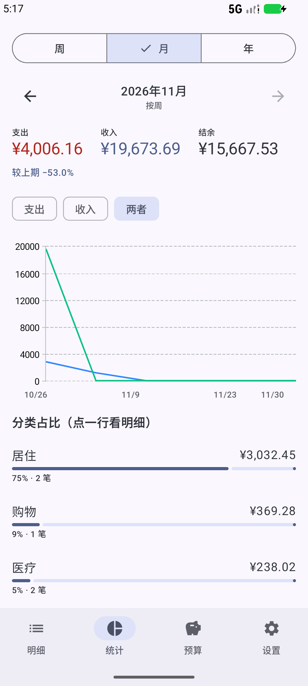 |  |

| 设置（示例数据 / 清空） | 删除后可撤销 |
| --- | --- |
| 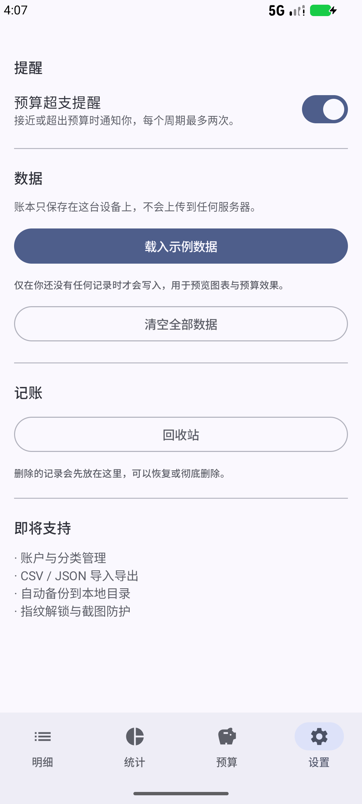 | 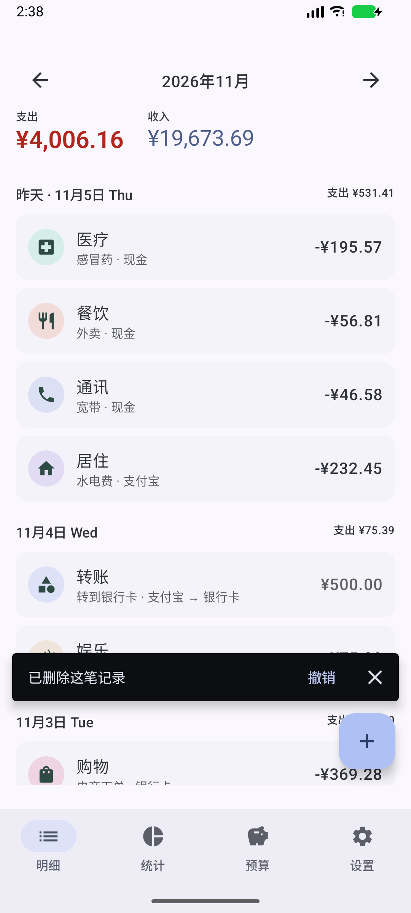 |

| 退款（从支出详情发起） | 预算编辑器 |
| --- | --- |
| 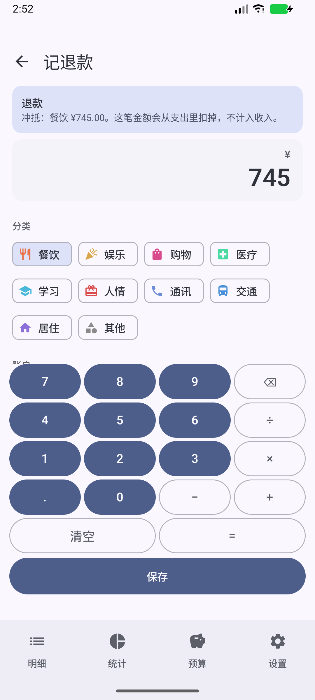 | 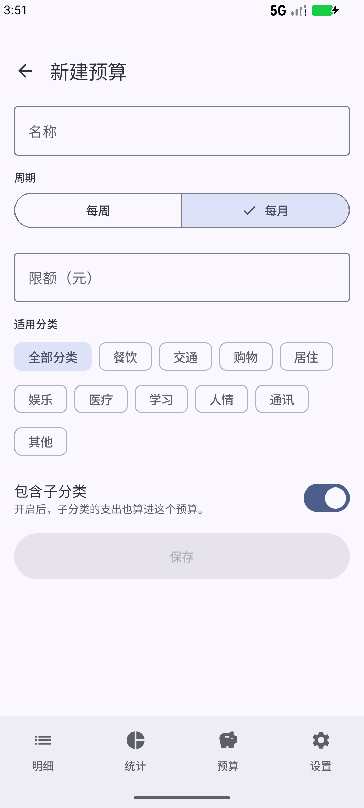 |

| 记一笔（底部弹层 + 计算器键盘） | 回收站 |
| --- | --- |
|  |  |

| 分类下钻（点占比行看明细） | 导入前预览 |
| --- | --- |
| 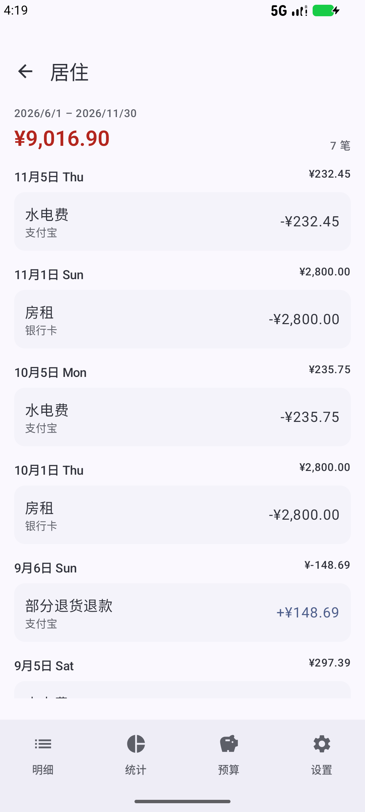 | 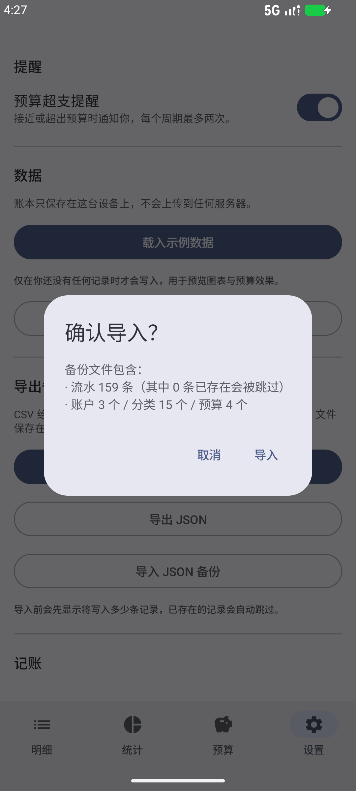 |

| 简约风格 | 扁平风格 |
| --- | --- |
| 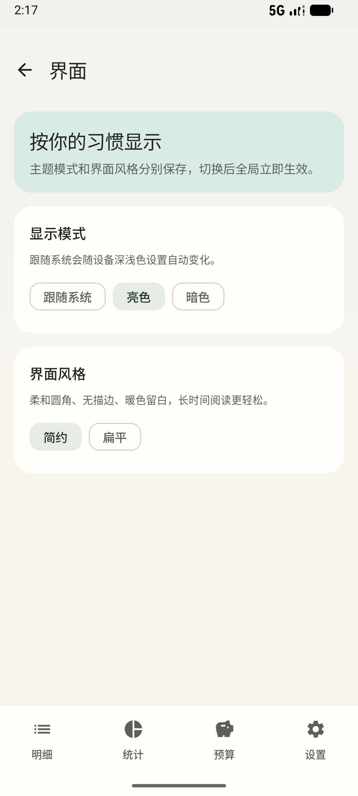 | 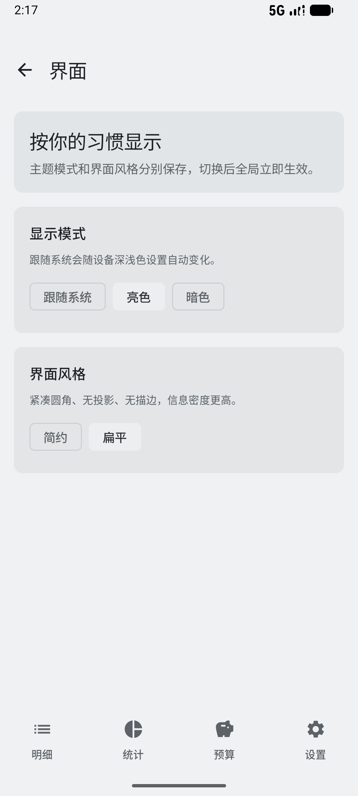 |

---

## 快速开始

环境要求：**JDK 17**、Android SDK（compileSdk 36）、Gradle 由 wrapper 提供。

```bash
# 构建 Debug APK
./gradlew :app:assembleDebug
# 产物：app/build/outputs/apk/debug/app-debug.apk

# JVM 测试（金额、金额输入、时间边界、分桶）
./gradlew :core:model:test :core:common:testDebugUnitTest :core:data:testDebugUnitTest

# 真机仪器化测试（需要已连接的设备或模拟器）
./gradlew :core:database:assembleDebugAndroidTest
adb install -r core/database/build/outputs/apk/androidTest/debug/database-debug-androidTest.apk
adb shell am instrument -w com.tallybook.core.database.test/androidx.test.runner.AndroidJUnitRunner
```

Windows 上用 `gradlew.bat`。首次构建约 2 分钟（Hilt / KSP 编译期处理）。

正式 Release 由 GitHub Actions 构建。仓库需要在 **Settings → Secrets and variables → Actions**
中配置以下 Secrets，密钥和密码不会进入源码或构建日志：

| Secret | 内容 |
| --- | --- |
| `ANDROID_KEYSTORE_BASE64` | release keystore 文件的 Base64 |
| `ANDROID_KEYSTORE_PASSWORD` | keystore 密码 |
| `ANDROID_KEY_ALIAS` | key alias |
| `ANDROID_KEY_PASSWORD` | key 密码 |

Windows 生成 keystore Base64：

```powershell
[Convert]::ToBase64String(
  [IO.File]::ReadAllBytes("D:\secure\tallybook-release.jks")
) | Set-Clipboard
```

推送符合版本号的标签后，工作流会构建、校验签名、生成 SHA-256 并创建预发布 Release：

```bash
git tag v0.1.0-beta.1
git push origin v0.1.0-beta.1
```

如果 Gradle 找不到 SDK，在根目录建 `local.properties`：

```properties
sdk.dir=C:/Users/<you>/AppData/Local/Android/Sdk
```

> 注意用正斜杠或双反斜杠 —— `.properties` 里单反斜杠是非法转义。

### 看演示数据

1. 打开 App → 底部「设置」
2. 点「载入示例数据」→ 自动生成最近 90 天的账单、3 个月工资、1 笔转账、1 笔退款、3 个预算
3. 回到「明细 / 统计 / 预算」查看效果

示例数据**只在账本为空时写入**，不会污染真实记录。「清空全部数据」可恢复空账本。

---

## 文档

| 文档 | 内容 |
| --- | --- |
| [架构设计](docs/ARCHITECTURE.md) | 分层、模块边界、金额与分桶建模、关键取舍 |
| [开发路线图](docs/ROADMAP.md) | 分阶段交付计划与验收标准 |
| [功能清单](docs/FEATURES.md) | 完整功能盘点（含未入路线的功能）与数据模型缺口 |
| [隐患清单](docs/RISKS.md) | **已修复的 9 个真实缺陷**、未修复风险、平台与工程风险 |

> 建议先读 [RISKS.md](docs/RISKS.md) 的 §A：里面记录了 9 个真实发生过的缺陷
> （金额累加恒错、周视图图表永远为 0、转账余额不变、撤销后看不到变化……），
> 每个都写清了根因与教训，比架构图更能说明这个项目的坑在哪。

---

## 技术栈

| 关注点 | 选型 | 版本 |
| --- | --- | --- |
| 语言 / UI | Kotlin + Jetpack Compose + Material3 | Kotlin 2.2.20 / Compose BOM 2025.11 |
| 导航 | Navigation Compose（类型安全 Serializable 路由） | 2.9.5 |
| 本地存储 | Room（KSP、`exportSchema`、显式迁移） | 2.8.3 |
| 依赖注入 | Hilt（编译期校验） | 2.58 |
| 异步 | Kotlin Coroutines + `StateFlow` | 1.10.2 |
| 序列化 | kotlinx.serialization | 1.9.0 |
| 图表 | Vico（Compose 原生，折线 + 柱状） | 2.1.4 |
| 构建 | AGP 8.13.1 / Gradle 8.14 / 版本目录 | — |

`minSdk 26` 意味着 `java.time` 原生可用，无需 core library desugaring。

---

## 架构一览

```
:app                    单 Activity + NavHost + 主题
 └── :feature:transactions / :insights / :budget / :settings   Compose + ViewModel
      └── :core:data                                    Repository + 分桶 + 预算评估 + 种子数据
           ├── :core:database                           Room Entity / DAO / Migration
           ├── :core:model                              Money / AmountInput / Transaction（纯 JVM）
           ├── :core:common                             Clock / DateProvider（周月年边界）
           └── :core:ui                                 Material3 主题与共用组件
```

依赖只允许自上而下；`:core:model` 不含任何 Android 依赖，因此测试是秒级的。

---

## 五条不能破的规矩

1. **金额永远用 `Money`（Long 最小单位）** —— 不碰 `Double`。
   `Money.plus` 在币种不同时抛异常，这是刻意的。
2. **金额输入走 `AmountInput` 引擎** —— 用户会输入 `12.5+3.8`，求值必须用 `BigDecimal`。
3. **数据库只往前迁移，绝不 destructive** —— 用户的账本就是资产。
   改了 Entity 就升 `version` + 写 `Migration` + 提交 schema JSON。
4. **所有查询都要过滤 `deleted_at IS NULL`**，聚合都要排除 `kind = 'TRANSFER'`。
5. **退款是独立一条 `INCOME` + `refundOfId`**，不是负数支出，也不计入收入。

---

## 功能现状

| 功能 | 状态 |
| --- | --- |
| 记一笔（自定义键盘 / 分类 / 账户 / 转账 / 日期 / 备注） | ✅ 可用 |
| 明细列表（月份切换 / 日分组 / 小计 / 编辑 / 删除 / 撤销） | ✅ 可用 |
| 跨月搜索与筛选（备注 / 分类 / 账户 / 收支类型） | ✅ 可用 |
| 外观设置（系统 / 亮色 / 暗色 + 简约 / 扁平） | ✅ 可用 |
| 统计图表（周·月·年 × 支出·收入·两者，折线 + 柱状） | ✅ 可用 |
| 分类占比排行 + 下钻到明细 | ✅ 可用 |
| 周 / 月预算（新建 / 编辑 / 删除 + 进度、配速、期末超支推算） | ✅ 可用 |
| 退款（编辑支出 → 退款 → 自动预填） | ✅ 可用，支出抵扣、不计收入 |
| 默认分类与账户、示例数据 | ✅ 可用 |
| 分类管理（增改 / 归档 / 使用次数） | ✅ 可用 |
| 账户管理（增改 / 初始余额 / 归档） | ✅ 可用 |
| 分类按使用频率排序 | ✅ 可用 |
| 回收站（恢复 / 彻底删除 / 清空） | ✅ 可用 |
| 账户 / 分类 / 标签管理 UI | ❌ 待做（Phase 1 剩余） |
| 日历热力图、图表无障碍描述 | ❌ 待做（Phase 2 剩余） |
| 超支提醒（80% / 超支各一次，去重 + 开关 + 每日后台检查） | ✅ 可用 |
| 预算历史 | ❌ 待做（Phase 3 剩余） |
| CSV / JSON 导出（SAF，含 BOM 与公式注入防护） | ✅ 可用 |
| JSON 导入（预览 + 幂等 + 事务） | ✅ 可用 |
| CSV 导入、自动备份、云同步 | ❌ 待做（Phase 4 剩余） |
| 隐私锁 / 加密 / 截图防护 | ❌ 待做（Phase 5） |
| 桌面小组件 / 快捷方式 | ❌ 待做 |

未实现功能的优先级见 [功能清单](docs/FEATURES.md)；已知隐患与"明确不做"的范围见 [隐患清单](docs/RISKS.md)。

---

## 已知限制

- 切换设备时区后，历史报表分桶可能变化。
- 数据库未加密，尚未提供生物识别应用锁。
- CSV 导入、账户对账、周期记账和多账本尚未实现。

完整发布说明见 [CHANGELOG.md](CHANGELOG.md)。

## 许可证

[Apache License 2.0](LICENSE)
